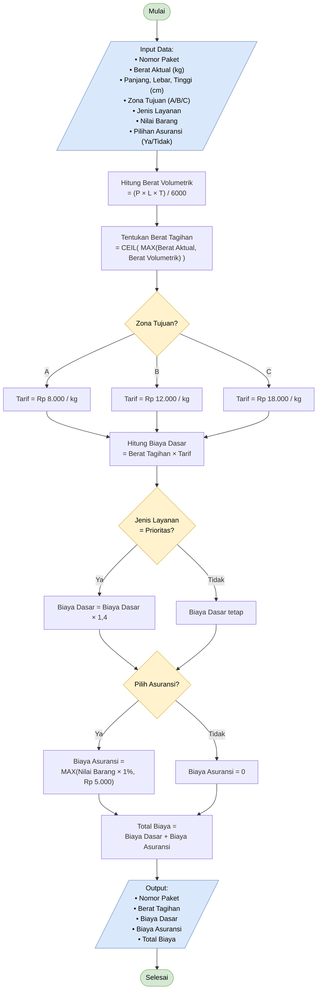

# Flowchart Modul A: Perhitungan Biaya Pengiriman

Dokumen ini berisi flowchart proses perhitungan biaya pengiriman paket, beserta penjelasan setiap langkah dan aturan bisnisnya.

## Flowchart

## Penjelasan Langkah

| No | Langkah | Keterangan |
|----|---------|------------|
| 1 | **Input Data** | Nomor paket, berat aktual (kg), dimensi P × L × T (cm), zona tujuan (A/B/C), jenis layanan, nilai barang, dan pilihan asuransi. |
| 2 | **Berat Volumetrik** | `(Panjang × Lebar × Tinggi) / 6000` |
| 3 | **Berat Tagihan** | `CEIL( MAX(Berat Aktual, Berat Volumetrik) )`, diambil yang terbesar lalu dibulatkan ke atas. |
| 4 | **Tentukan Tarif** | Berdasarkan zona tujuan (lihat tabel tarif). |
| 5 | **Biaya Dasar** | `Berat Tagihan × Tarif` |
| 6 | **Cek Layanan Prioritas** | Jika Prioritas, Biaya Dasar dikalikan 1,4. Jika tidak, tetap. |
| 7 | **Cek Asuransi** | Jika dipilih: `MAX(Nilai Barang × 1%, Rp 5.000)`. Jika tidak: Rp 0. |
| 8 | **Total Biaya** | `Biaya Dasar + Biaya Asuransi` |
| 9 | **Output** | Nomor paket, berat tagihan, biaya dasar, biaya asuransi, dan total biaya. |

## Tabel Tarif per Zona

| Zona | Tarif per kg |
|------|--------------|
| A | Rp 8.000 |
| B | Rp 12.000 |
| C | Rp 18.000 |

## Aturan Bisnis

- **Pembagi volumetrik:** 6000
- **Pembulatan:** berat tagihan selalu dibulatkan ke atas (`CEIL`) ke kilogram penuh.
- **Layanan Prioritas:** pengali 1,4 pada biaya dasar.
- **Asuransi:** 1% dari nilai barang, dengan minimum Rp 5.000.
- **Catatan:** asuransi tidak ikut dikalikan faktor Prioritas, karena pengali hanya diterapkan pada Biaya Dasar.

## Contoh Perhitungan

**Data:** berat aktual 2 kg, dimensi 40 × 30 × 20 cm, Zona B, layanan Prioritas, nilai barang Rp 1.000.000, asuransi Ya.

1. Berat volumetrik = (40 × 30 × 20) / 6000 = 24.000 / 6000 = **4 kg**
2. Berat tagihan = CEIL(MAX(2, 4)) = **4 kg**
3. Tarif Zona B = **Rp 12.000/kg**
4. Biaya dasar = 4 × 12.000 = **Rp 48.000**
5. Prioritas: 48.000 × 1,4 = **Rp 67.200**
6. Asuransi = MAX(1.000.000 × 1%, 5.000) = MAX(10.000, 5.000) = **Rp 10.000**
7. Total biaya = 67.200 + 10.000 = **Rp 77.200**
