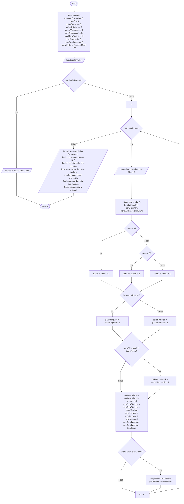

**Penanggung jawab:** Aning Dwi Setyowati / 322610002

## Flowchart

### Gambar Diagram Alir 

> - Garis pada diagram dibuat lurus (siku-siku). Kode Mermaid di bawah memakai `curve: linear` agar garisnya juga lurus; salin ke [mermaid.live](https://mermaid.live) untuk diekspor sebagai **SVG** atau **PNG**.

---

### Kode Sumber Diagram Alir (Mermaid)

