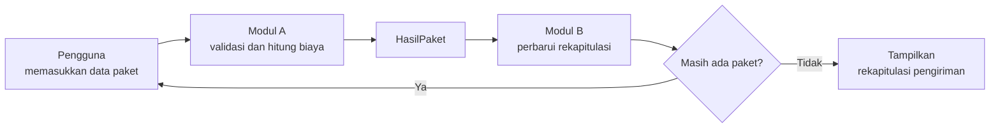

# Sistem Perhitungan Biaya Pengiriman Paket

Proyek UTS **Algoritma dan Pengantar Pemrograman (SSI1144)**, Program Studi Sistem Informasi, Universitas Ma Chung.

Program konsol berbahasa C++ yang menghitung biaya pengiriman setiap paket (berat tagihan, tarif zona, layanan prioritas, dan asuransi), lalu menyusun rekapitulasi seluruh paket dalam satu kali jalan.

## Daftar Isi

1. [Identitas Proyek](#1-identitas-proyek)
2. [Tentang Program](#2-tentang-program)
3. [Aturan Perhitungan Biaya](#3-aturan-perhitungan-biaya)
4. [Cara Kerja Program](#4-cara-kerja-program)
5. [Struktur Repository](#5-struktur-repository)
6. [Cara Kompilasi dan Menjalankan](#6-cara-kompilasi-dan-menjalankan)
7. [Dokumen Pendukung](#7-dokumen-pendukung)
8. [Batasan Program](#8-batasan-program)

---

## 1. Identitas Proyek

| Item | Keterangan |
|------|------------|
| Mata kuliah | Algoritma dan Pengantar Pemrograman (SSI1144) |
| Studi kasus | 04: Sistem Perhitungan Biaya Pengiriman Paket |
| Bahasa | C++ (aplikasi konsol) |
| Repository | [Sistem-Perhitungan-Biaya-Pengiriman-Paket](https://github.com/jetrofabian28/Sistem-Perhitungan-Biaya-Pengiriman-Paket) |

### Anggota Kelompok

| Nama | NIM | Modul |
|------|-----|-------|
| Fabian Jethro Falah Kalangi | 322610015 | Modul A: Proses Utama |
| Aning Dwi Setyowati | 322610002 | Modul B: Rekapitulasi |

Integrasi kedua modul, pengujian, dan dokumentasi dikerjakan bersama.

---

## 2. Tentang Program

Biaya pengiriman tidak hanya ditentukan oleh berat timbangan. Paket yang ringan tetapi besar dihitung dengan berat volumetrik, dan biaya juga bergantung pada zona tujuan, jenis layanan, serta asuransi. Program ini mengotomatiskan perhitungan tersebut.

| Modul | Tugas |
|-------|-------|
| **Modul A: Proses Utama** | Membaca dan memvalidasi data paket, menentukan berat tagihan, menghitung biaya dasar, tambahan layanan prioritas, biaya asuransi, dan total biaya, lalu menampilkan rincian per paket |
| **Modul B: Rekapitulasi** | Mengakumulasi hasil seluruh paket dan menampilkan laporan akhir: jumlah paket per zona dan layanan, total berat, jumlah paket berat volumetrik, total asuransi, total pendapatan, dan paket dengan biaya tertinggi |
| **Program terintegrasi** | Menghubungkan kedua modul melalui struct `HasilPaket` sehingga setiap paket yang selesai dihitung langsung direkap |

---

## 3. Aturan Perhitungan Biaya

| No | Komponen | Aturan |
|----|----------|--------|
| 1 | Berat volumetrik | (panjang x lebar x tinggi) / 6000 |
| 2 | Berat tagihan | Nilai terbesar antara berat aktual dan berat volumetrik, dibulatkan ke atas |
| 3 | Tarif per kg | Zona A Rp8.000, zona B Rp12.000, zona C Rp18.000 |
| 4 | Biaya dasar | Berat tagihan x tarif zona |
| 5 | Layanan prioritas | Tambahan 40% dari biaya dasar |
| 6 | Asuransi | 1% dari nilai barang, minimum Rp5.000 (jika dipilih) |
| 7 | Total biaya | Biaya dasar + tambahan layanan + asuransi |

---

## 4. Cara Kerja Program



Untuk setiap paket, program memanggil fungsi berikut secara berurutan:

1. `bacaDataPaket()` membaca dan memvalidasi masukan (Modul A).
2. `hitungBiaya()` menghitung seluruh komponen biaya (Modul A).
3. `tampilkanRincian()` menampilkan rincian biaya (Modul A).
4. `perbaruiRekap()` menambahkan hasil ke rekapitulasi (Modul B).

Setelah semua paket selesai, `tampilkanRekapitulasi()` mencetak laporan akhir (Modul B).

---

## 5. Struktur Repository

> Susunan berikut menggambarkan berkas utama proyek. Sesuaikan dengan isi repository yang sebenarnya.

```text
Sistem-Perhitungan-Biaya-Pengiriman-Paket/
├── README.md                              # Dokumentasi utama (berkas ini)
├── main.cpp                               # Source code final (Modul A + Modul B)
├── modul_b.cpp                            # Source code Modul B
├── docs/
│   ├── analisis-masalah.md                # Latar belakang, aturan, IPO, variabel
│   ├── proses-integrasi-program.md        # Cara Modul A dan B digabung
│   ├── pseudocode-flowchart-final.md      # Pseudocode dan flowchart final
│   ├── hasil-eksekusi-terintegrasi.md     # Hasil menjalankan program
│   ├── tabel-pengujian-trace-table.md     # 19 kasus uji dan trace table
│   ├── daftar-kesalahan-dan-perbaikan.md  # Kesalahan yang ditemukan dan solusinya
│   ├── refleksi-proyek-uts.md             # Refleksi kelompok
│   └── pernyataan-penggunaan-ai.md        # Transparansi penggunaan AI
└── gambar/
    └── flowchart.svg                      # Flowchart Modul B
```

---

## 6. Cara Kompilasi dan Menjalankan

Pastikan kompiler C++ (GCC/MinGW atau Clang) sudah terpasang.

### Program terintegrasi (utama)

```bash
g++ -o main main.cpp
./main
```

Di Windows, jalankan `main.exe`.

### Modul B saja

```bash
g++ -o modul_b modul_b.cpp
./modul_b
```

Untuk memeriksa peringatan kompilasi, tambahkan `-Wall -Wextra`:

```bash
g++ -Wall -Wextra -o main main.cpp
```

---

## 7. Dokumen Pendukung

| Dokumen | Isi |
|---------|-----|
| [Analisis Masalah](docs/analisis-masalah.md) | Latar belakang, tujuan, aturan, analisis input-proses-output, dan daftar variabel |
| [Proses Integrasi Program](docs/proses-integrasi-program.md) | Titik temu Modul A dan Modul B, tahapan penggabungan, dan urutan eksekusi |
| [Pseudocode dan Flowchart Final](docs/pseudocode-flowchart-final.md) | Rancangan akhir program terintegrasi |
| [Hasil Eksekusi](docs/hasil-eksekusi-terintegrasi.md) | Tampilan menjalankan program pada data valid dan tidak valid |
| [Tabel Pengujian dan Trace Table](docs/tabel-pengujian-trace-table.md) | 19 kasus uji dan penelusuran nilai variabel |
| [Daftar Kesalahan dan Perbaikan](docs/daftar-kesalahan-dan-perbaikan.md) | Kesalahan yang ditemukan, penyebab, dan perbaikannya |
| [Refleksi](docs/refleksi-proyek-uts.md) | Pembagian kerja, tantangan, pembelajaran, dan rencana UAS |
| [Pernyataan Penggunaan AI](docs/pernyataan-penggunaan-ai.md) | Alat AI yang digunakan dan pemeriksaan hasilnya |

---

## 8. Batasan Program

- Program berhenti jika ada satu masukan tidak valid, tanpa meminta pengulangan masukan.
- Data tiap paket tidak disimpan setelah rekapitulasi dicetak.
- Tarif dan aturan biaya masih tertulis di dalam kode.
- Memakai `struct` dan fungsi sederhana; belum memakai array, class, berkas, atau database.
