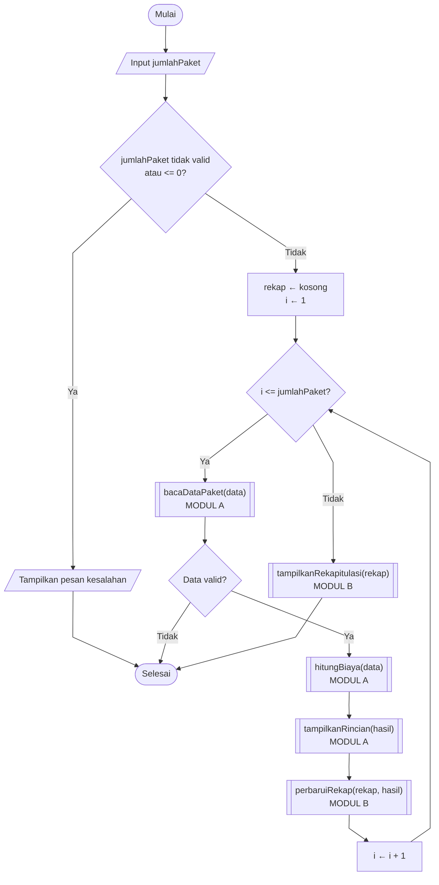
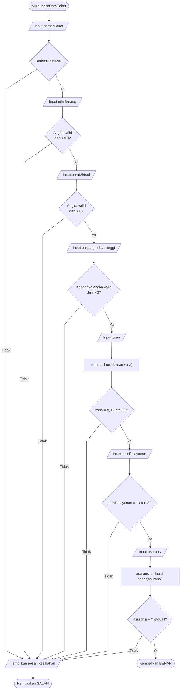
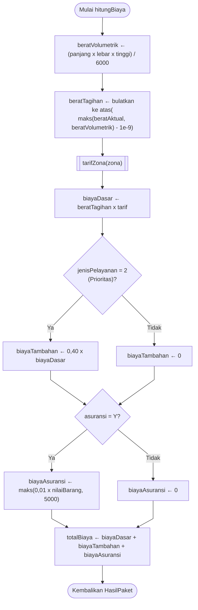
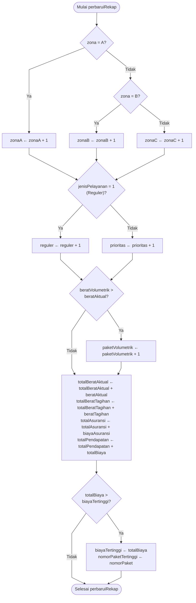

**Penanggung jawab:**
- Fabian Jethro Falah Kalangi - 322610015
- Aning Dwi Setyowati - 322610002

## Pseudocode dan Flowchart Final Program Terintegrasi

Studi Kasus 04: Sistem Perhitungan Biaya Pengiriman Paket (Modul A dan Modul B)

### 1. Tujuan dan Ruang Lingkup

Dokumen ini memuat rancangan akhir program terintegrasi, yaitu pseudocode dan flowchart yang sesuai dengan source code `integrasi.cpp`. Rancangan disusun dalam dua tingkat:

1. **Tingkat program utama:** alur keseluruhan dari membaca jumlah paket sampai menampilkan rekapitulasi.
2. **Tingkat fungsi:** rincian isi fungsi `bacaDataPaket`, `hitungBiaya`, dan `perbaruiRekap`.

---

### 2. Kamus Data

#### 2.1 Konstanta

| Nama | Nilai | Keterangan |
|------|-------|------------|
| `TARIF_ZONA_A` | 8000 | Tarif per kg zona A (Rp) |
| `TARIF_ZONA_B` | 12000 | Tarif per kg zona B (Rp) |
| `TARIF_ZONA_C` | 18000 | Tarif per kg zona C (Rp) |

#### 2.2 Tipe Data Bentukan

| Tipe | Anggota | Peran |
|------|---------|-------|
| `DataPaket` (masukan Modul A) | nomorPaket, nilaiBarang, beratAktual, panjang, lebar, tinggi, zona, jenisPelayanan, asuransi | Menampung data satu paket dari pengguna |
| `HasilPaket` (keluaran Modul A, masukan Modul B) | nomorPaket, zona, jenisPelayanan, beratAktual, beratVolumetrik, beratTagihan, biayaDasar, biayaTambahan, biayaAsuransi, totalBiaya | Menampung hasil hitung satu paket |
| `RekapPengiriman` (Modul B) | zonaA, zonaB, zonaC, reguler, prioritas, paketVolumetrik, totalBeratAktual, totalBeratTagihan, totalAsuransi, totalPendapatan, biayaTertinggi (awal -1), nomorPaketTertinggi (awal "-") | Menampung seluruh data rekapitulasi |

---

### 3. Pseudocode Final

#### 3.1 Algoritma Utama

```text
ALGORITMA ProgramTerintegrasi
KAMUS
  jumlahPaket, i : integer
  data           : DataPaket
  hasil          : HasilPaket
  rekap          : RekapPengiriman

DESKRIPSI
  TAMPILKAN "Masukkan jumlah paket"
  BACA jumlahPaket
  JIKA jumlahPaket tidak valid ATAU jumlahPaket <= 0 MAKA
    TAMPILKAN "Jumlah paket harus berupa bilangan bulat lebih dari 0."
    SELESAI
  AKHIR JIKA

  rekap ← RekapPengiriman kosong      // semua pencacah dan total 0, biayaTertinggi = -1
  i ← 1

  ULANGI SELAMA i <= jumlahPaket
    TAMPILKAN "Data Paket ke-i"

    // ----- MODUL A -----
    JIKA bacaDataPaket(data) = SALAH MAKA
      SELESAI                          // pesan kesalahan sudah ditampilkan
    AKHIR JIKA
    hasil ← hitungBiaya(data)
    tampilkanRincian(hasil)

    // ----- MODUL B -----
    perbaruiRekap(rekap, hasil)

    i ← i + 1
  AKHIR ULANGI

  tampilkanRekapitulasi(rekap)         // MODUL B
SELESAI
```

#### 3.2 Fungsi `bacaDataPaket` (Modul A)

```text
FUNGSI bacaDataPaket(data : DataPaket) → boolean
DESKRIPSI
  BACA data.nomorPaket
  JIKA gagal dibaca MAKA
    TAMPILKAN "Nomor paket tidak valid."; KEMBALIKAN SALAH

  BACA data.nilaiBarang
  JIKA bukan angka valid ATAU nilaiBarang < 0 MAKA
    TAMPILKAN "Nilai barang harus berupa angka yang tidak negatif."; KEMBALIKAN SALAH

  BACA data.beratAktual
  JIKA bukan angka valid ATAU beratAktual <= 0 MAKA
    TAMPILKAN "Berat aktual harus berupa angka lebih dari 0."; KEMBALIKAN SALAH

  BACA data.panjang
  JIKA bukan angka valid ATAU panjang <= 0 MAKA
    TAMPILKAN "Panjang harus berupa angka lebih dari 0."; KEMBALIKAN SALAH

  BACA data.lebar
  JIKA bukan angka valid ATAU lebar <= 0 MAKA
    TAMPILKAN "Lebar harus berupa angka lebih dari 0."; KEMBALIKAN SALAH

  BACA data.tinggi
  JIKA bukan angka valid ATAU tinggi <= 0 MAKA
    TAMPILKAN "Tinggi harus berupa angka lebih dari 0."; KEMBALIKAN SALAH

  BACA data.zona
  data.zona ← HURUF BESAR(data.zona)
  JIKA data.zona BUKAN "A", "B", atau "C" MAKA
    TAMPILKAN "Zona tujuan harus A, B, atau C."; KEMBALIKAN SALAH

  BACA data.jenisPelayanan
  JIKA jenisPelayanan BUKAN 1 atau 2 MAKA
    TAMPILKAN "Jenis pelayanan harus 1 (Reguler) atau 2 (Prioritas)."; KEMBALIKAN SALAH

  BACA data.asuransi
  data.asuransi ← HURUF BESAR(data.asuransi)
  JIKA data.asuransi BUKAN "Y" atau "N" MAKA
    TAMPILKAN "Pilihan asuransi harus Y atau N."; KEMBALIKAN SALAH

  KEMBALIKAN BENAR
```

#### 3.3 Fungsi `tarifZona` (Modul A)

```text
FUNGSI tarifZona(zona : char) → real
DESKRIPSI
  JIKA zona = "A" MAKA KEMBALIKAN TARIF_ZONA_A
  JIKA zona = "B" MAKA KEMBALIKAN TARIF_ZONA_B
  KEMBALIKAN TARIF_ZONA_C
```

#### 3.4 Fungsi `hitungBiaya` (Modul A)

```text
FUNGSI hitungBiaya(data : DataPaket) → HasilPaket
KAMUS
  hasil : HasilPaket
DESKRIPSI
  hasil.nomorPaket      ← data.nomorPaket
  hasil.zona            ← data.zona
  hasil.jenisPelayanan  ← data.jenisPelayanan
  hasil.beratAktual     ← data.beratAktual
  hasil.beratVolumetrik ← (data.panjang x data.lebar x data.tinggi) / 6000
  hasil.beratTagihan    ← BULATKAN KE ATAS(MAKS(hasil.beratAktual, hasil.beratVolumetrik) - 1e-9)
  hasil.biayaDasar      ← hasil.beratTagihan x tarifZona(data.zona)

  JIKA data.jenisPelayanan = 2 MAKA
    hasil.biayaTambahan ← 0,40 x hasil.biayaDasar
  SELAIN ITU
    hasil.biayaTambahan ← 0
  AKHIR JIKA

  JIKA data.asuransi = "Y" MAKA
    hasil.biayaAsuransi ← MAKS(0,01 x data.nilaiBarang, 5000)
  SELAIN ITU
    hasil.biayaAsuransi ← 0
  AKHIR JIKA

  hasil.totalBiaya ← hasil.biayaDasar + hasil.biayaTambahan + hasil.biayaAsuransi
  KEMBALIKAN hasil
```

#### 3.5 Prosedur `tampilkanRincian` (Modul A)

```text
PROSEDUR tampilkanRincian(hasil : HasilPaket)
DESKRIPSI
  TAMPILKAN "Rincian Biaya Paket", hasil.nomorPaket
  TAMPILKAN zona tujuan, berat volumetrik, berat tagihan
  TAMPILKAN biaya dasar, biaya tambahan pelayanan, biaya asuransi
  TAMPILKAN total biaya
```

#### 3.6 Prosedur `perbaruiRekap` (Modul B)

```text
PROSEDUR perbaruiRekap(rekap : RekapPengiriman, hasil : HasilPaket)
DESKRIPSI
  JIKA hasil.zona = "A" MAKA
    rekap.zonaA ← rekap.zonaA + 1
  SELAIN ITU JIKA hasil.zona = "B" MAKA
    rekap.zonaB ← rekap.zonaB + 1
  SELAIN ITU
    rekap.zonaC ← rekap.zonaC + 1
  AKHIR JIKA

  JIKA hasil.jenisPelayanan = 1 MAKA
    rekap.reguler ← rekap.reguler + 1
  SELAIN ITU
    rekap.prioritas ← rekap.prioritas + 1
  AKHIR JIKA

  JIKA hasil.beratVolumetrik > hasil.beratAktual MAKA
    rekap.paketVolumetrik ← rekap.paketVolumetrik + 1
  AKHIR JIKA

  rekap.totalBeratAktual  ← rekap.totalBeratAktual + hasil.beratAktual
  rekap.totalBeratTagihan ← rekap.totalBeratTagihan + hasil.beratTagihan
  rekap.totalAsuransi     ← rekap.totalAsuransi + hasil.biayaAsuransi
  rekap.totalPendapatan   ← rekap.totalPendapatan + hasil.totalBiaya

  JIKA hasil.totalBiaya > rekap.biayaTertinggi MAKA
    rekap.biayaTertinggi      ← hasil.totalBiaya
    rekap.nomorPaketTertinggi ← hasil.nomorPaket
  AKHIR JIKA
```

#### 3.7 Prosedur `tampilkanRekapitulasi` (Modul B)

```text
PROSEDUR tampilkanRekapitulasi(rekap : RekapPengiriman)
DESKRIPSI
  TAMPILKAN "REKAPITULASI PENGIRIMAN"
  TAMPILKAN jumlah paket zona A, zona B, zona C
  TAMPILKAN jumlah paket reguler dan prioritas
  TAMPILKAN total berat aktual dan total berat tagihan
  TAMPILKAN jumlah paket yang menggunakan berat volumetrik
  TAMPILKAN total asuransi dan total pendapatan
  TAMPILKAN paket dengan biaya tertinggi beserta nilainya
```

---

### 4. Keterangan Simbol Flowchart

| Simbol (Mermaid) | Arti |
|------------------|------|
| `([ ... ])` | Awal atau akhir (terminator) |
| `[/ ... /]` | Masukan atau keluaran |
| `[ ... ]` | Proses |
| `{ ... }` | Keputusan |
| `[[ ... ]]` | Pemanggilan fungsi atau prosedur (proses terdefinisi) |

Seluruh flowchart memakai `curve: linear` agar garisnya lurus.

---

### 5. Flowchart Final

#### 5.1 Flowchart Program Utama


> Salin kode Mermaid di bawah ke [mermaid.live](https://mermaid.live), lalu ekspor sebagai **SVG** dengan nama `gambar/flowchart-integrasi-final.svg`.



#### 5.2 Flowchart Fungsi `bacaDataPaket` (Modul A)



#### 5.3 Flowchart Fungsi `hitungBiaya` (Modul A)



#### 5.4 Flowchart Prosedur `perbaruiRekap` (Modul B)



---

### 6. Kesesuaian Pseudocode, Flowchart, dan Source Code

| No | Bagian | Modul | Pseudocode | Flowchart | Source code (`integrasi.cpp`) |
|----|--------|-------|------------|-----------|-------------------------------|
| 1 | Alur program utama | Integrasi | 3.1 | 5.1 | `main()` |
| 2 | Membaca dan validasi masukan | A | 3.2 | 5.2 | `bacaDataPaket()` |
| 3 | Penentuan tarif zona | A | 3.3 | Dipanggil pada 5.3 | `tarifZona()` |
| 4 | Perhitungan biaya | A | 3.4 | 5.3 | `hitungBiaya()` |
| 5 | Tampil rincian paket | A | 3.5 | Dipanggil pada 5.1 | `tampilkanRincian()` |
| 6 | Pembaruan rekap | B | 3.6 | 5.4 | `perbaruiRekap()` |
| 7 | Tampil rekapitulasi | B | 3.7 | Dipanggil pada 5.1 | `tampilkanRekapitulasi()` |

### 7. Catatan

1. Pada `bacaDataPaket`, berat aktual diperiksa lebih dulu, lalu panjang, lebar, dan tinggi satu per satu. Pada flowchart 5.2, pemeriksaan panjang, lebar, dan tinggi digabung dalam satu langkah agar diagram tetap ringkas. Di source code ketiganya diperiksa terpisah dengan pesan kesalahan masing-masing.
2. Setiap kegagalan validasi menampilkan pesan lalu mengembalikan nilai salah, sehingga `main()` menghentikan program dan `perbaruiRekap()` tidak pernah dipanggil untuk data yang tidak valid.
3. Nilai awal `biayaTertinggi = -1` memastikan paket pertama selalu tercatat sebagai biaya tertinggi sementara.
4. Dua nama anggota rekap pada pseudocode dipersingkat agar mudah dibaca: `paketVolumetrik` di source code bernama `menggunakanBeratVolumetrik`, dan `nomorPaketTertinggi` di source code bernama `nomorPaketBiayaTertinggi`. Fungsinya sama.
